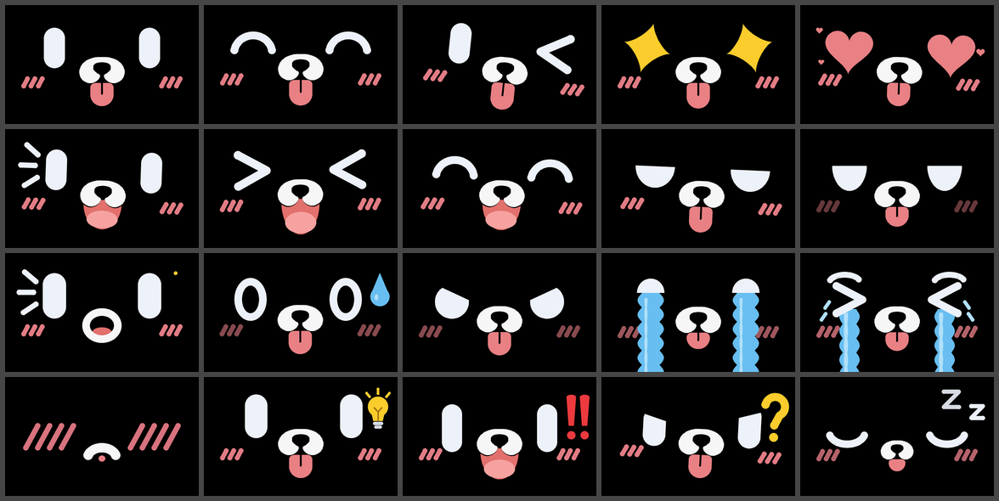

# 모니펫 직접 만들기

노트북 화면 위에 올리는 강아지 **모니펫**의 보드 프로그램, 얼굴 그림, 케이스 파일이에요.

앱만 쓸 거라면 이 파일들은 필요 없어요. → **[모니펫 홈페이지](https://tech-bgs.github.io/monipet/)**



## 준비물

| 무엇 | 설명 |
|---|---|
| 보드 | Waveshare ESP32-S3-Touch-AMOLED-1.64. 뒷면에 **Rev1**이라고 적힌 보드에서 확인했어요. 다른 판은 화면이 안 나올 수 있어요. |
| USB-C 선 | 데이터가 되는 선 |
| 3D 프린터 | Bambu Lab A1, PLA로 확인했어요. |
| 맥 | 모니펫 앱을 쓸 M1 이상 맥 |

## 1. 보드에 모니펫 넣기

Python 3.11 이상이 필요해요. 보드를 USB로 꽂고, 보드를 쓰는 다른 앱은 꺼 주세요.

```bash
cd board/install
python3 -m venv .venv
.venv/bin/python -m pip install -r tools/requirements.txt
ls /dev/cu.usbmodem*
.venv/bin/python tools/install.py flash --board amoled-1.64 --bundle bundle --port /dev/cu.usbmodem1101 --confirmed-board
```

마지막 줄의 `/dev/cu.usbmodem1101`은 바로 윗줄에서 나온 이름으로 바꿔 주세요.

- 잘 되면 강아지 얼굴이 나와요.
- 화면이 검게만 나오면 보드의 판이 다른 것일 수 있어요.

## 2. 케이스 (시험판)

`case/monipet-case-v11b.3mf` (Bambu Studio) 또는 `case/monipet-case-v11b.stl`. 노란 귀는 `case/monipet-ears-yellow.3mf`예요.

- 보드는 **왼쪽 옆으로** 밀어 넣어요. 뒤집어도 빠지지 않는 것을 확인했어요.
- **옆 입구 마감이 아직 거칠어요.** 입구 안쪽에도 서포트를 켜고 뽑는 것을 권해요. 다음 판에서 고칠 거예요.
- 아래 홈은 **5mm**예요. 노트북 화면용이고, 두꺼운 모니터에는 맞지 않아요.

## 3. 앱과 연결하기

모니펫 앱을 켜고 보드를 USB로 꽂으면 앱이 스스로 찾아요. 보드를 꾹 누르고 말한 다음 손을 떼면 돼요.

## 어디에서 왔나요

- 보드 프로그램은 [TRIIIS-LABS/firmware-taby](https://github.com/TRIIIS-LABS/firmware-taby) (커밋 `e7051ac`, Apache License 2.0)를 고쳐서 만들었어요. 바꾼 내용은 `board/source/monipet-changes.patch`에 있어요. 화면 핀을 46번으로 바꾸고, 이름과 얼굴 그림을 모니펫 것으로 바꿨어요.
- 모니펫은 Taby나 TRIIIS LABS의 공식 제품이 아니에요. Taby의 캐릭터 그림은 들어 있지 않아요.
- 얼굴 그림과 케이스는 모니펫을 위해 새로 만든 거예요.
- 다른 사람이 만든 것들의 라이선스는 `board/LICENSE-firmware`, `board/install/bundle/NOTICE`, `board/install/bundle/licenses`에 있어요.

## 써도 되나요

| 무엇 | 조건 |
|---|---|
| 케이스, 설명서, 우리가 고친 보드 프로그램 | 뽑고, 고치고, 나누고, 팔아도 돼요. 사용 조건과 출처를 남겨 주세요. (Apache License 2.0) |
| 강아지 얼굴과 움직임 | 쓰고, 고치고, 나눠도 돼요. **모니펫이라고 밝혀 주세요.** 내가 만든 캐릭터라고 하거나, 다른 이름으로 바꿔 내놓거나 팔면 안 돼요. |
| 모니펫 맥 앱 | 이 저장소의 조건에 들어가지 않아요. |

자세한 내용은 [LICENSE](LICENSE)에 있어요.
